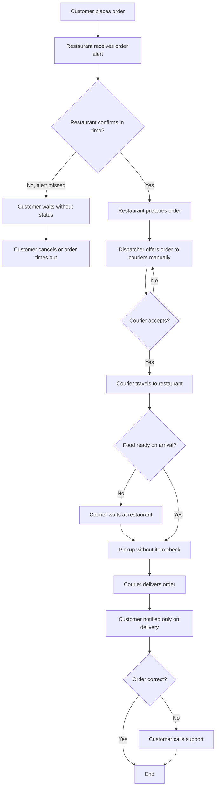
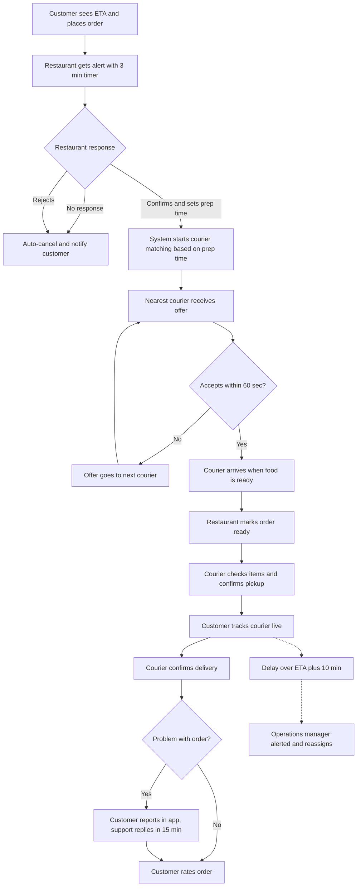

# Process Analysis: Order Fulfilment

Order process before (AS-IS) and after (TO-BE) the proposed improvements.
Goals G1, G2, G3 are defined in [business-case.md](../01-business-case/business-case.md).
User stories (US-xx) are defined in [user-stories.md](../02-requirements/user-stories.md).

## 1. AS-IS Process

## 2. Bottlenecks

| ID | AS-IS problem | Impact | Goal |
|---|---|---|---|
| B1 | No confirmation timer for restaurants | Missed orders, cancellations | G2 |
| B2 | Preparation time is not shared with couriers | Couriers wait or arrive early, late delivery | G1 |
| B3 | Courier assignment is manual | Slow assignment at peak hours | G1 |
| B4 | Customer gets status only on delivery | Anxiety, complaints, cancellations | G3 |
| B5 | No item check at pickup | Wrong or missing items | G3 |
| B6 | Problems are reported by phone | Slow resolution, low rating | G3 |
| B7 | No monitoring of delayed orders | Late orders are noticed too late | G1 |

## 3. TO-BE Process

## 4. Bottleneck to Solution Mapping

| ID | TO-BE change | User stories | Goal |
|---|---|---|---|
| B1 | 3-minute confirmation timer with auto-cancel | US-05 | G2 |
| B2 | Restaurant sets prep time, courier matching is timed to it | US-07, US-08 | G1 |
| B3 | Automatic assignment to the nearest courier with 60 sec accept window | US-09 | G1 |
| B4 | ETA before ordering and live status tracking | US-01, US-02 | G3 |
| B5 | Item checklist at pickup | US-11 | G3 |
| B6 | In-app problem reporting with 15 min support reply | US-04 | G3 |
| B7 | Delay alerts and KPI dashboard for operations | US-12, US-13 | G1, G2 |