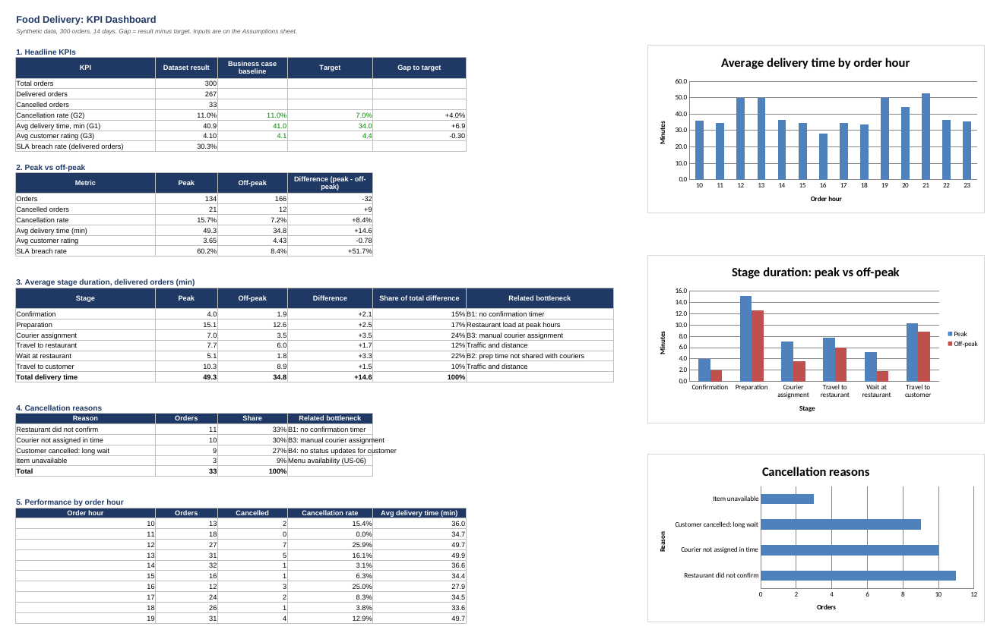

# Data Analysis Summary

Analysis of 300 synthetic orders (14-27 Sep 2026) for the fictional platform FoodGo.
Full calculations: [food-delivery-analysis.xlsx](food-delivery-analysis.xlsx) (sheets: Dashboard, Data, Assumptions).

> All data is synthetic and created for demonstration purposes.

## 1. Headline KPIs

| KPI | Result | Target | Gap |
|---|---|---|---|
| Cancellation rate (G2) | 11.0% | 7.0% | +4.0 pp |
| Avg delivery time (G1) | 40.9 min | 34 min | +6.9 min |
| Avg customer rating (G3) | 4.10 | 4.4 | -0.30 |
| SLA breach rate (delivery over 45 min) | 30.3% | not set | - |

The dataset matches the baseline in the [business case](../01-business-case/business-case.md).

## 2. Key Findings

**1. The problem is concentrated in peak hours.**
Peak hours (12:00-14:00 and 19:00-22:00) bring 45% of orders, but performance is much worse than off-peak:

| Metric | Peak | Off-peak |
|---|---|---|
| Cancellation rate | 15.7% | 7.2% |
| Avg delivery time | 49.3 min | 34.8 min |
| Avg rating | 3.65 | 4.43 |
| SLA breach rate | 60.2% | 8.4% |

Off-peak performance is already close to the targets. The gap exists mainly because of peak hours.

**2. Most of the peak delay comes from three controllable stages.**
Peak orders take 14.6 minutes longer. Stage by stage:

| Stage | Extra minutes at peak | Share of delay | Related bottleneck |
|---|---|---|---|
| Courier assignment | +3.5 | 24% | B3: manual courier assignment |
| Wait at restaurant | +3.3 | 22% | B2: prep time not shared with couriers |
| Preparation | +2.5 | 17% | Restaurant load |
| Confirmation | +2.1 | 15% | B1: no confirmation timer |
| Travel to restaurant | +1.7 | 12% | Traffic and distance |
| Travel to customer | +1.5 | 10% | Traffic and distance |

Confirmation, assignment and waiting together explain 61% of the extra delay. These stages are process problems, not traffic problems.

**3. Most cancellations are caused by the process.**
Of 33 cancelled orders, 30 (91%) are linked to bottlenecks: restaurant did not confirm (33%), courier not assigned in time (30%), customer cancelled after a long wait (27%). Only 9% were caused by unavailable items.

**4. Two clear peaks in delivery time.**
Average delivery time is about 50 minutes for orders placed at 12:00-13:59, and between 44 and 53 minutes at 19:00-21:59 (maximum at 21:00 with 52.5 min). It drops back to about 35 minutes outside these hours.

**5. District differences exist but are not conclusive.**
Binagadi has the slowest delivery (45.5 min) and the lowest rating (3.88). Each district has only 26-49 orders, so a larger dataset is needed before drawing conclusions.

## 3. Expected Impact (simple estimate)

If confirmation, courier assignment and restaurant wait at peak hours were reduced to off-peak levels, peak deliveries would be about 8.9 minutes faster. Peak orders are 42% of delivered orders, so the average delivery time would fall from 40.9 to about 37.2 minutes.
This reaches about 55% of the way to the 34 minute target. The remaining gap needs improvements in preparation time and travel, which are covered in the recommendations.

## 4. Method and Limitations
- Metrics are calculated with Excel formulas (COUNTIFS, AVERAGEIFS), so the workbook recalculates if the data or assumptions change.
- Delivery time is the sum of six AS-IS process stages. Cancelled orders have no stage times or rating.
- The SLA threshold (45 min), peak hours and targets are inputs on the Assumptions sheet.
- The estimate in section 3 assumes stage improvements are independent and does not model demand changes.
